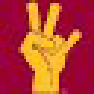
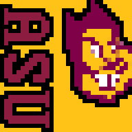
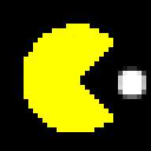
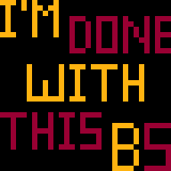
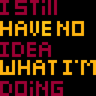
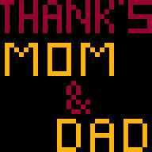
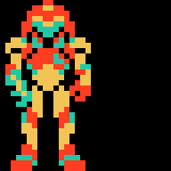
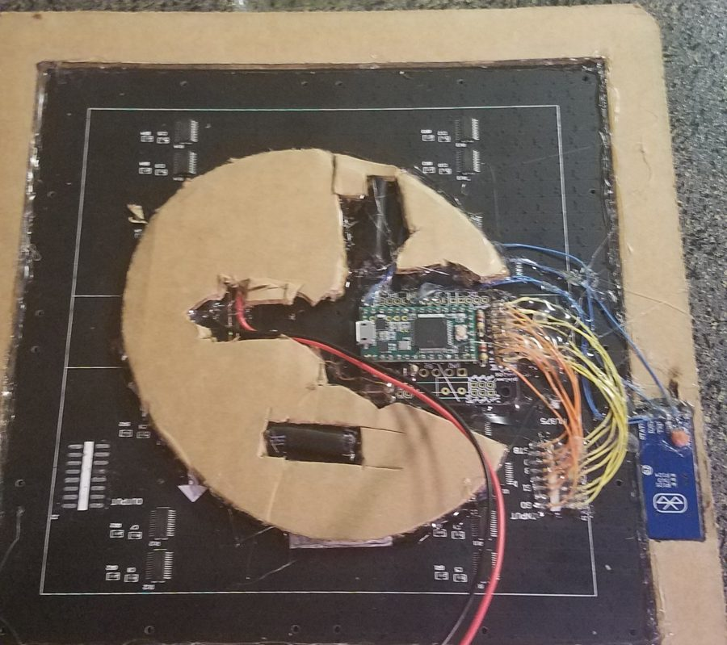

# LED Graduation Cap

A graduation cap with a 32×32 RGB LED matrix on top, built for my Arizona State graduation in spring 2017 (the code and artwork date from April–May 2017). It plays pixel-art GIFs from an SD card, scrolls text, and is controlled from a phone over Bluetooth: pick an animation, queue up a sequence, send a message, or change the brightness.

| | | | |
|---|---|---|---|
|  |  |  |  |
|  |  |  |  |

*Some of the animations from `Images/Ready to load/gifs/`, shown 6× bigger than the 32×32 panel.*

## Hardware

*The back of the cap: the LED panel set into the cardboard top, with the Teensy and its wiring to the panel's input, and the Bluetooth module on the right.*

| Part | Notes |
|---|---|
| Teensy 3.1 / 3.2 | Runs the SmartMatrix library |
| SmartMatrix shield with microSD slot | SD card chip select on pin 15 |
| 32×32 HUB75 RGB LED panel | 1/16 scan (`SMARTMATRIX_HUB75_32ROW_MOD16SCAN`) |
| Bluetooth serial module (HC-05/HC-06 style) | On `Serial1` (Teensy pins 0/1) at 9600 baud |
| 5 V battery pack | For the panel and the Teensy |

## Sketches

| Folder | What it is |
|---|---|
| `my_grad_cap/` | The final version, with Bluetooth control |
| `my_grad_cap_no_bt/` | Same display code without Bluetooth: cycles through every GIF on the card, 5 seconds each |
| `graduation_cap/` | The earlier version (April 2017), based more closely on the SmartMatrix AnimatedGIFs example |

The GIF decoder (`GIFDecoder.h`, `GIFParseFunctions.cpp`, `LZWFunctions.cpp`, `FilenameFunctions.cpp`) is Craig A. Lindley's, from the [SmartMatrix AnimatedGIFs example](https://github.com/pixelmatix/AnimatedGIFs) (MIT licence), with small changes.

## Bluetooth commands

On power-up the cap waits for any message from the phone, replies `Connected`, then accepts these (any Bluetooth serial terminal app works):

| Send | Does |
|---|---|
| `3` | Play GIF number 3 (its position in the SD card's `/gifs/` folder) |
| `(1 4 7)` | Play a sequence: GIFs 1, 4 and 7 in turn, 5 seconds each, looping |
| `*Hello!` | Scroll the text "Hello!" across the panel in gold |
| `$off` / `$on` | Blank the panel / turn it back on |
| `$setBrightness 128` | Brightness, 1–255 |

## Building

1. Arduino IDE with [Teensyduino](https://www.pjrc.com/teensy/td_download.html), board set to Teensy 3.1/3.2.
2. Install **SmartMatrix3 3.0.1** (the version this was written against) and use Teensyduino's **SD** library.
3. Open `my_grad_cap/my_grad_cap.ino` and upload.
4. Copy the GIFs from `Images/Ready to load/gifs/` into a `/gifs/` folder on a FAT-formatted microSD card. GIFs must be 32×32 or smaller.

## Images

`Images/` holds the Photoshop sources (`.psd`) for the artwork and the exported GIFs. `Images/Ready to load/gifs/` is the set that went on the SD card.

## Notes

- `my_grad_cap.ino` was left half-edited in November 2018 and no longer compiled; it's been tidied up so both sketches build for a Teensy 3.1.
- The Arduino libraries and the Google Drive zip downloads in the original folder aren't included in the repo (see `.gitignore`).
